<h1 align="center">Tavrix</h1>

<p align="center">
  <b>An SSH terminal, file manager and code editor for your servers, in one Mac window.</b>
</p>

<p align="center">
  <a href="https://github.com/farookhridoy/tavrix/releases/latest"></a>
  
  <a href="LICENSE"></a>
</p>

<p align="center">
  <a href="https://tavrix.farookhridoy.com">Website</a> ·
  <a href="#download-and-install">Download</a> ·
  <a href="#quick-start">Quick start</a> ·
  <a href="#a-tour-of-tavrix">Tour</a> ·
  <a href="#keyboard-shortcuts">Shortcuts</a> ·
  <a href="docs/MANUAL.md">Full manual</a> ·
  <a href="#troubleshooting">Troubleshooting</a>
</p>

<p align="center">
  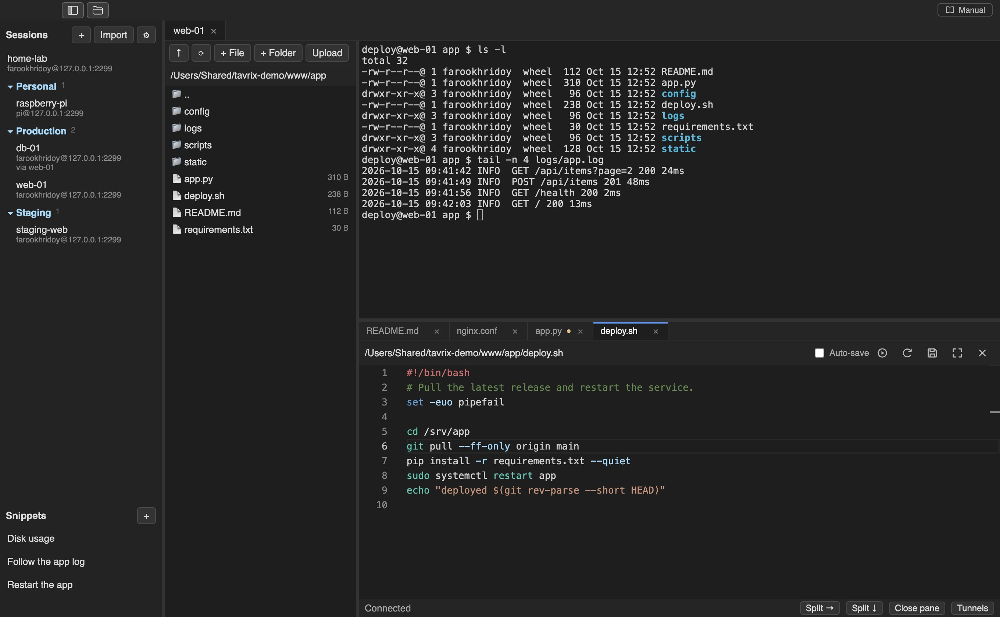
</p>

> [!IMPORTANT]
> **The first time you open Tavrix, macOS shows a warning. That is expected.** Tavrix is not signed by a paid Apple Developer account. Click **Done** (not *Move to Trash*), then open **System Settings → Privacy & Security → Open Anyway**. [Step-by-step instructions](#how-to-install-and-open-tavrix).

Tavrix connects to your servers over SSH and gives you everything you reach for in one place: a **terminal**, a **file browser** you can drag files into, and an **editor with tabs** that saves straight back to the server. No separate SFTP client, no copy-pasting paths.

## Features

| | |
|---|---|
| **Terminal** | Several shells on one connection, split side by side or stacked, resizable by dragging. Themes, fonts, scrollback. |
| **File manager** | Click to open folders, drag files from Finder to upload, right-click to download, rename, change permissions or delete. Permissions are kept, so scripts stay executable. |
| **Editor** | A tab per open file, syntax highlighting, auto-save, a warning if the file changed on the server, one-click *make executable*, and a full-screen mode. |
| **Sessions** | Saved in folders. Passwords and key passphrases are encrypted with the macOS Keychain. Import hosts from `~/.ssh/config`. |
| **Jump hosts** | Reach a private server through a bastion, including chains. |
| **Tunnels** | Local (`-L`), remote (`-R`) and SOCKS5 (`-D`) port forwarding with a simple form. |
| **Snippets** | Save commands you type often and insert them with a click. Nothing runs until you press Enter. |
| **Safe by default** | Server fingerprints are checked and a changed key is blocked. One network connection per session. No telemetry. |
| **Light** | About 85 MB to download. |

## Download and install

Get the installer for your Mac from the **[Releases page](https://github.com/farookhridoy/tavrix/releases/latest)**:

| Your Mac | File | Size |
|---|---|---|
| Apple Silicon (M1 and later) | `Tavrix-…-arm64.dmg` | about 85 MB |
| Intel | `Tavrix-…-x64.dmg` | about 96 MB |

Not sure which one? Apple menu → **About This Mac** shows the chip.

### How to install and open Tavrix

> [!IMPORTANT]
> Do not skip steps 2 and 3. Tavrix is not signed by a paid Apple Developer account, so macOS says **"Apple could not verify "Tavrix" is free of malware…"** the first time you open a downloaded copy. Nothing is wrong with your download, and you only need to do this once.

1. **Install.** Open the `.dmg` and drag **Tavrix** into **Applications**.
2. **Open it once.** Open Tavrix from Applications. When macOS shows the warning, click **Done**. *Do not click Move to Trash.*
3. **Allow it.** Open **System Settings → Privacy & Security**, scroll down to **Security**, click **Open Anyway** next to Tavrix and enter your password.
4. **Use it.** Open Tavrix again and click **Open**. Click **+** to add your first server. A short tour starts by itself.

**Prefer Terminal?** Run this once, then open Tavrix normally:

```
xattr -dr com.apple.quarantine /Applications/Tavrix.app
```

Seeing *"Tavrix is damaged"* or *"Not Opened"* instead? It is the same thing and the same fix.

### Verify your download

Each release lists a SHA-256 checksum for both installers. Compare it with your file's:

```
shasum -a 256 ~/Downloads/Tavrix-*.dmg
```

The two values must match exactly. The source code is open, so you can also [build it yourself](#build-it-yourself).

### Updates

Tavrix shows a blue bar when a newer version is published, with **Download**, **Release notes**, **Later** and **Skip this version**. It only opens the download page in your browser; it never installs anything by itself. Check any time with **Tavrix menu → Check for Updates…**.

## Quick start

The first time you open Tavrix, a short **quick tour** points out the main controls. You can close it any time and bring it back from **Help → Quick Tour**.

<p align="center">
  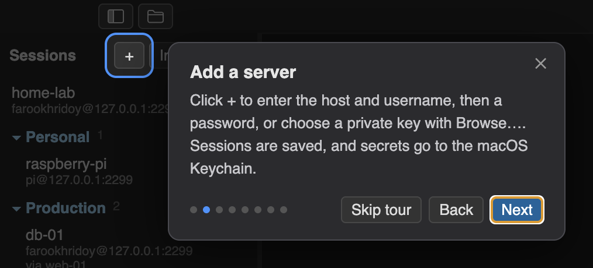
</p>

**1. Add a server.** Click **+** in the sidebar, enter the host and username, then a password *or* choose your private key with **Browse…**.

<p align="center">
  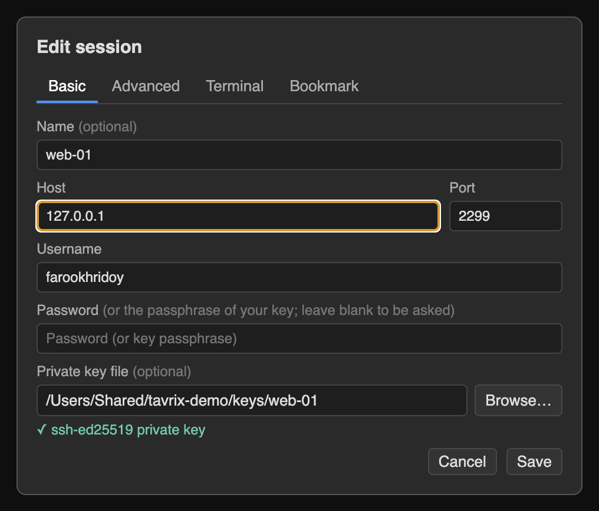
  &nbsp;
  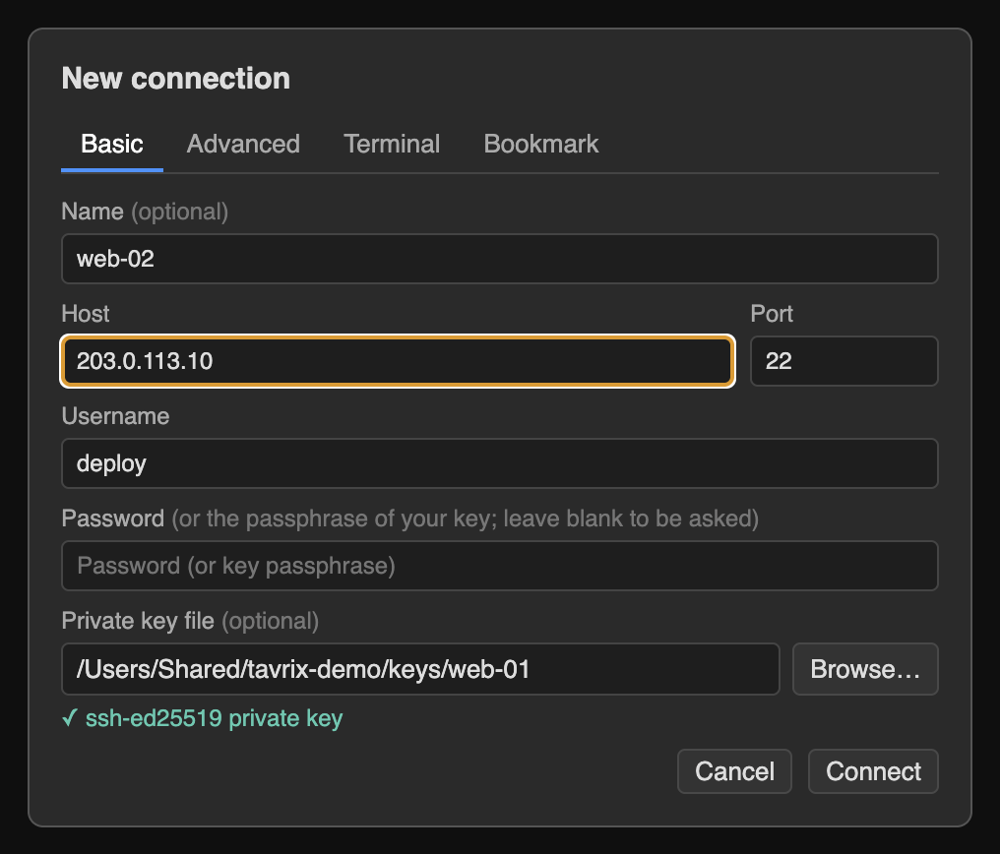
</p>

Tavrix tells you what you picked: a private key, an encrypted key (it will ask for the passphrase), or a `.pub` file that will not work.

**2. Connect.** Click the session in the sidebar. The first time, Tavrix shows the server's fingerprint and asks whether to trust it.

**3. Work.** Type in the terminal, click folders in the file panel, double-click a file to edit it, and press **⌘S** to save.

That is all you need. Everything below is optional.

## A tour of Tavrix

### Organize your servers

Put sessions in folders from the session's **Bookmark** tab, give production servers their own look in the **Terminal** tab, and set connection options in **Advanced**.

<p align="center">
  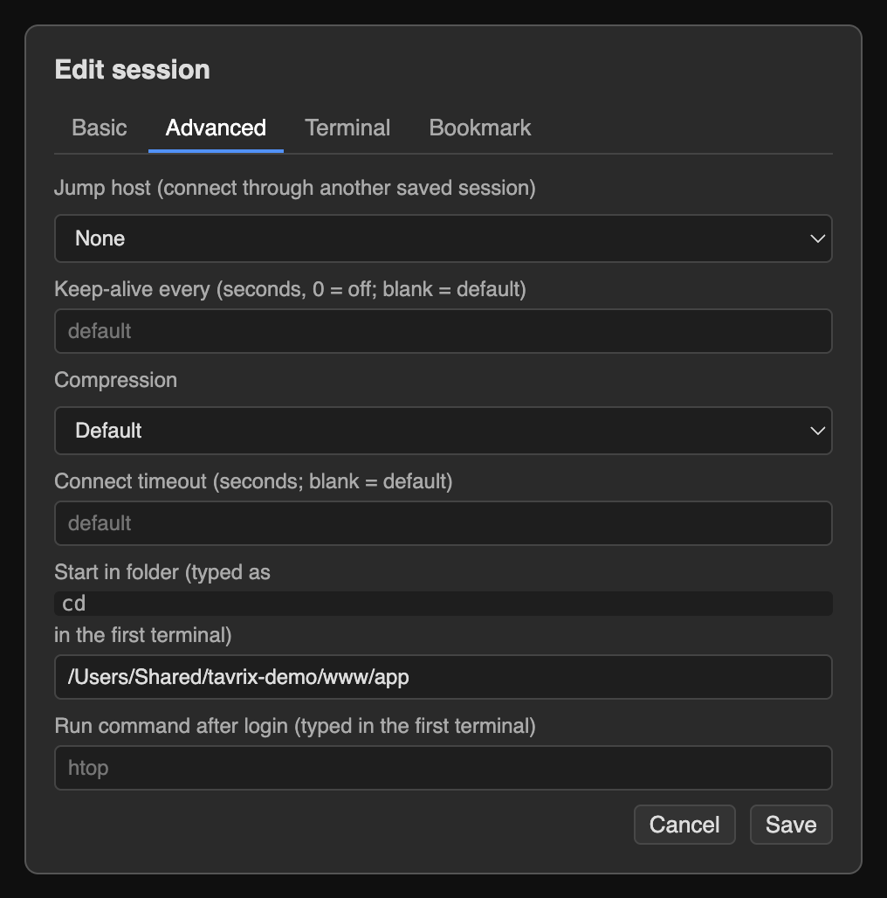
  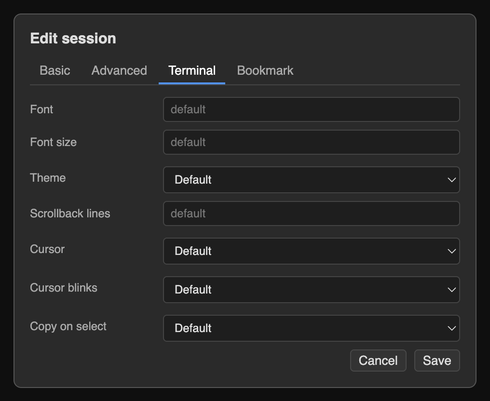
  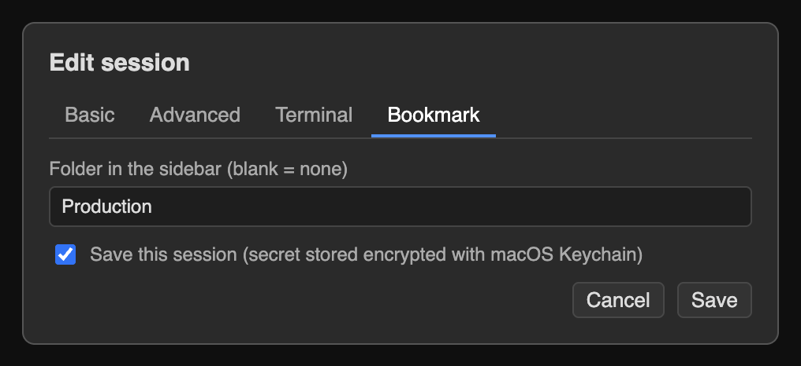
</p>

- **Jump host**: connect through another saved session first.
- **Keep-alive** (30 s by default) stops routers from dropping an idle session.
- **Start in folder** and **Run command after login** are typed into the first terminal where you can see them.
- **Import** in the sidebar reads `~/.ssh/config`.

### Several terminals

**Split →** and **Split ↓** add terminals on the same connection. Drag a divider to resize; double-click it to make them equal again.

<p align="center">
  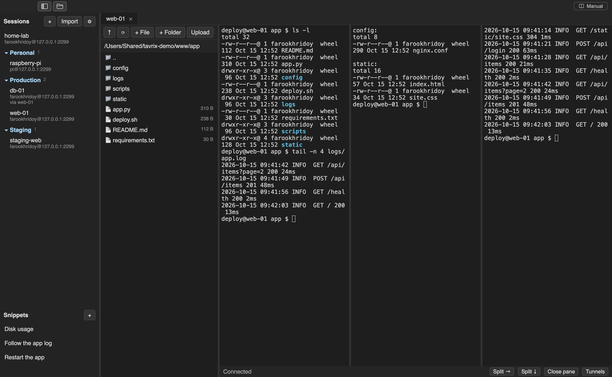
</p>

### Files

Click a folder to open it, double-click a file to edit it. Right-click for **Download**, **Rename**, **Permissions** and **Delete**. Drag files or folders from Finder onto the panel to upload them, with a progress bar and a **Cancel** button.

### Edit with tabs

Every file opens in its own tab. A dot ● marks unsaved changes. If someone changes a file on the server, Tavrix notices: an unedited file reloads itself, and saving over a changed file asks first. The icons in the editor bar make a `#!` script executable, reload from the server, save, go full screen, and close the file; hover over each for a tooltip.

<p align="center">
  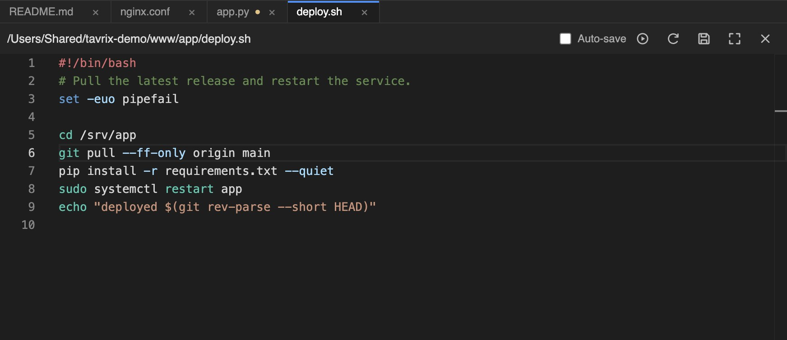
</p>

For long stretches in a file, press **⌘⇧F** to give the editor the whole window; **Esc** brings everything back.

<p align="center">
  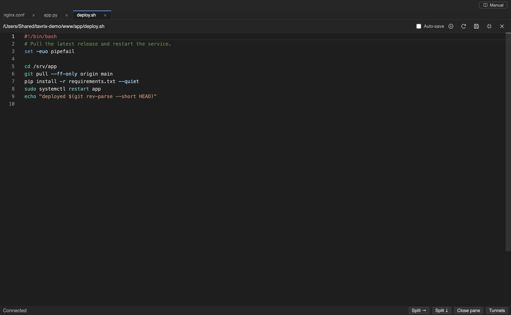
</p>

### Port forwarding

**Tunnels** in the status bar opens a form for local, remote and SOCKS5 forwarding. Listening addresses default to your Mac only.

<p align="center">
  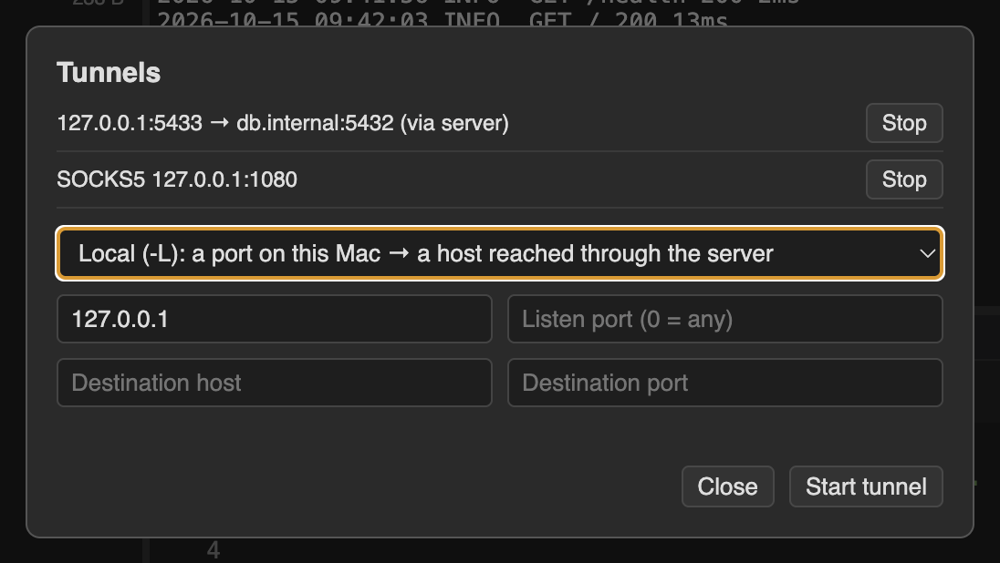
</p>

### Snippets

Save commands you type often. A multi-line snippet is pasted as one block, and nothing runs until you press **Enter** (unless you tick *Press Enter after inserting*).

<p align="center">
  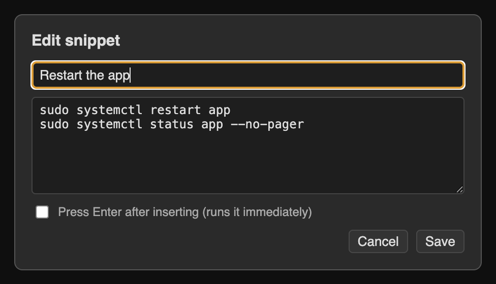
</p>

### Settings

Open with the **⚙** button or **⌘,**. Font, size, theme (Tavrix Dark, Light, Solarized Dark, Dracula, Monokai), scrollback, cursor, copy on select, and connection defaults. Changes apply to open terminals immediately, and any session can override them.

<p align="center">
  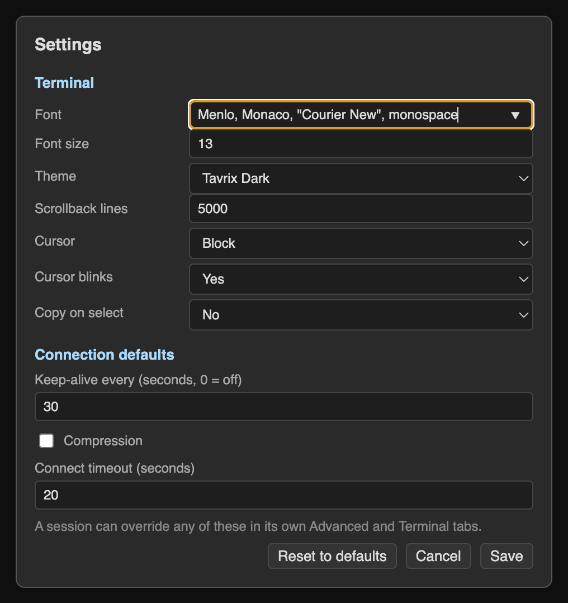
</p>

### Show, hide and resize

The two icons at the top left show or hide the sessions sidebar and the file panel (**⌘B** and **⌘⇧B**). Every thin divider can be dragged, and double-clicking a divider resets it. Tavrix remembers your layout.

### Help is built in

The **Manual** button (top right, or **F1**) opens the full documentation inside the app, with an **Open on GitHub** button for the same pages online.

<p align="center">
  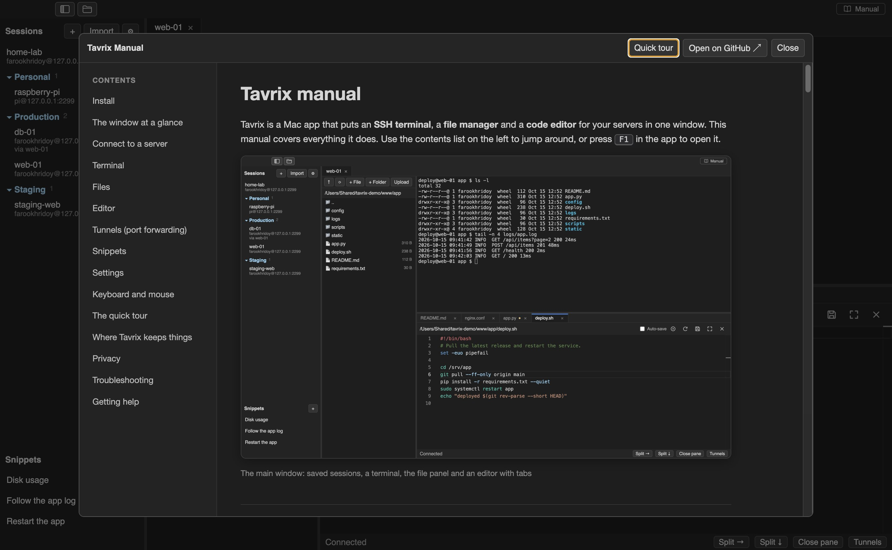
</p>

## Keyboard shortcuts

| Action | Shortcut |
|---|---|
| Settings | `⌘,` |
| Show or hide the sessions sidebar | `⌘B` |
| Show or hide the file panel | `⌘⇧B` |
| Full-screen editor on or off | `⌘⇧F` |
| Save the open file | `⌘S` |
| Open the manual | `F1` |
| Leave full-screen editor, close the tour | `Esc` |
| Resize a focused divider | arrow keys (`Shift` for bigger steps) |
| Reset a divider | double-click it |

## Your data and privacy

- Everything is stored in `~/Library/Application Support/Tavrix/`: saved sessions (secrets encrypted with the macOS Keychain), trusted server fingerprints, settings and snippets. Delete that folder to start fresh.
- Tavrix has **no accounts, analytics or telemetry**. Its only automatic network request is the update check: an anonymous request to `api.github.com` for this project's latest release (at launch, every 12 hours, and when you return to the window after an hour). GitHub sees your IP address. Turn it off with **Tavrix menu → Check for Updates Automatically**.
- Server fingerprints are verified on first connect. If a trusted server presents a different key, Tavrix blocks the connection.
- Tavrix opens only one network connection per session, however many terminals, files and tunnels you use.

## Troubleshooting

| Problem | What to do |
|---|---|
| macOS says Tavrix is "Not Opened" or "damaged" | Click **Done**, then **System Settings → Privacy & Security → Open Anyway**. See [the install steps](#how-to-install-and-open-tavrix). |
| "Authentication failed" | Check the username and password. If the server only accepts keys, choose your private key (not the `.pub` file). |
| "Host key has CHANGED" | The server presented a different key than the one you trusted. Do not connect unless you reinstalled it; then remove its entry from `known_hosts.json`. |
| The connection drops when idle | Lower **Keep-alive** on the session's Advanced tab. |
| The server blocks my IP after a few minutes | That is a server or provider rule (fail2ban, a firewall limit). Compare with `ssh -v` in Terminal and check the server's ban list. The [manual](docs/MANUAL.md#troubleshooting) has the steps. |
| A file will not open in the editor | It is binary, not UTF-8 text, or over 5 MB. Download it instead. |

More in the **[full manual](docs/MANUAL.md)**.

## Build it yourself

Tavrix is an [Electron](https://www.electronjs.org/) app written in TypeScript and plain JavaScript, using [ssh2](https://github.com/mscdex/ssh2) for SSH, [xterm.js](https://xtermjs.org/) for the terminal and [Monaco](https://microsoft.github.io/monaco-editor/) for the editor. It is developed and tested with Node.js 24.

```bash
git clone https://github.com/farookhridoy/tavrix.git
cd tavrix
npm ci
npm start            # build and run
npm test             # unit tests, plus integration tests when you give it a test server (below)
```

The integration tests talk to a real SSH server and are skipped unless you provide one: `TAVRIX_TEST_SSH=host:port:user:/path/to/key npm test`.

To build the installers (unsigned): `CSC_IDENTITY_AUTO_DISCOVERY=false npm run dist` produces `release/Tavrix-<version>-arm64.dmg` and `-x64.dmg`. Signing, notarization and the release steps are in [docs/RELEASING.md](docs/RELEASING.md). The manual shown inside the app is generated from [docs/MANUAL.md](docs/MANUAL.md) during the build.

```
src/main/        the app's main process: SSH, SFTP, tunnels, storage, menus, updates
src/renderer/    the window: terminals, file panel, editor, dialogs, tour
docs/            manual, release process, roadmap, images
scripts/         build helpers
```

## Roadmap and changelog

- [CHANGELOG.md](CHANGELOG.md): what changed in each version
- [docs/WEBSITE.md](docs/WEBSITE.md): how the website at tavrix.farookhridoy.com is built and deployed
- [docs/ROADMAP.md](docs/ROADMAP.md): what is planned (other session types such as SFTP-only, FTP and Telnet; saved tunnels; a signed build)

## Contributing

Bug reports and ideas are welcome on the [issue tracker](https://github.com/farookhridoy/tavrix/issues). Please include your macOS version, the Tavrix version (Tavrix menu → About), and what you expected to happen.

## License

[MIT](LICENSE). Third-party components keep their own licenses.
